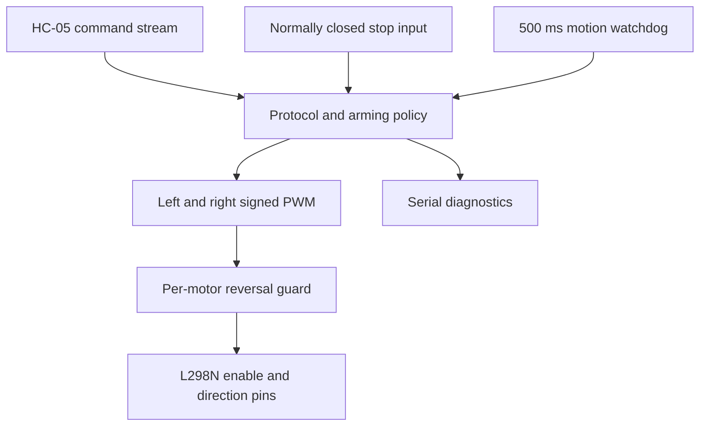

# Control architecture

Controller state starts disarmed. A arms without moving; S stops while retaining arming; X and unsupported bytes stop/disarm. Speed digits also stop until the next direction byte. F/B/L/R are the only bytes that refresh motion time, and only when armed. A stop-loop opening immediately disarms when sampled. A 500 ms lapse while driving disarms; a fresh A plus direction is then required.

Commands are single bytes, not framed packets. There is no checksum, sequence number, authentication or stale-packet detection. No link-state signal is used. Up to 16 bytes are processed per loop to bound parser work. Multiple commands received in one loop can collapse to the last target before outputs are applied; a transient S followed by a motion byte in that same batch is not a guaranteed physical pause. X requires a later A before motion; an independent motor-power cutoff is separate.

Each wheel's reversal guard disables output before requesting opposite polarity and waits 80 ms from that disable. A prior stop contributes to the neutral interval. Returning to the previous direction can resume without waiting. This reduces abrupt commanded reversal; it does not prove the wheel has physically stopped or guarantee current limits. Driver enable is set to zero before a changed direction is written. Stop uses disabled bridge/coast rather than dynamic braking.

D5/D6 supply PWM on UNO. The two motors share the selected speed magnitude; without encoders no matching of actual wheel RPM occurs. Logs report commands, not measured speed or current. The current tests exercise controller/guard functions but not physical GPIO, radio delivery, batteries or traction.
