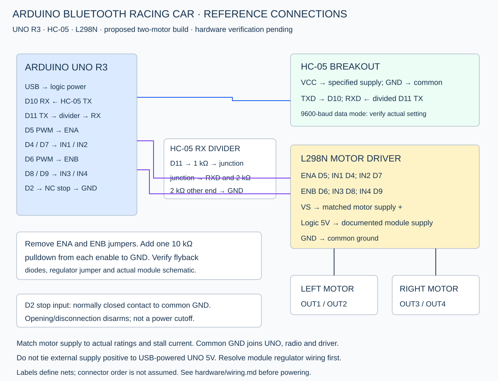

# Proposed UNO / HC-05 / L298N wiring

New reference design; not confirmed against the original car. Two motors, one per bridge. Disconnect power while wiring and raise the wheels for first tests.

| Connection | Destination |
|---|---|
| HC-05 TXD | UNO D10 (SoftwareSerial RX) |
| UNO D11 (SoftwareSerial TX) | 1 kΩ resistor to divider junction |
| Divider junction | HC-05 RXD and 2 kΩ resistor to GND |
| HC-05 GND | Common GND |
| HC-05 VCC | Breakout's specified regulated supply; model must be checked |
| L298N ENA | UNO D5 PWM; remove ENA jumper, add 10 kΩ to GND |
| L298N IN1 / IN2 | UNO D4 / D7 |
| L298N ENB | UNO D6 PWM; remove ENB jumper, add 10 kΩ to GND |
| L298N IN3 / IN4 | UNO D8 / D9 |
| L298N OUT1 / OUT2 | Left motor terminals |
| L298N OUT3 / OUT4 | Right motor terminals |
| Stop input | UNO D2 through normally closed switch to GND |
| Motor supply positive | L298N VS / motor-power input through switch and suitable protection |
| All required grounds | UNO, HC-05, driver and external supply GND |

## Logic and power

The 1 kΩ/2 kΩ divider reduces UNO's nominal 5 V TX to roughly 3.3 V at HC-05 RX. Verify the module's logic requirements. The HC-05 supply specification depends on bare-module vs regulated breakout construction; do not assume every VCC terminal accepts 5 V.

Use USB power for UNO during bench bring-up. Power motors from a separate source sized for their stall current and voltage. Provide driver logic 5 V using its documented module arrangement. For a module with a documented removable regulator-enable jumper and external logic input, disable that regulator before applying external regulated 5 V logic. Do not feed an external voltage into an enabled regulator output or connect it to the USB-powered UNO 5V rail. Unknown jumper arrangements must be resolved from the module schematic first.

ENA/ENB enable jumpers must be removed for PWM and disable control. Add separate 10 kΩ pulldowns on both enables so reset/high-impedance pins do not intentionally enable motion. Verify the module does not have conflicting pull-ups. Confirm flyback diodes are fitted; the bare L298 requires external inductive-load protection. Keep power wiring short, secure and appropriately rated, with suitable supply decoupling based on the actual module/motors.

Check BOTH motor stall current and driver thermal limits. The L298 has substantial voltage drop and heating; a headline chip current rating is not a guaranteed usable continuous rating for a small breakout. No particular battery voltage or motor current has been selected here. Do not power motors from the UNO 5V pin or a small rectangular 9 V battery as an assumed suitable source.

## Stop input

A normally closed switch connects D2 to GND; pressed/open or disconnected reads HIGH and disarms. An initial closed test jumper can be used only for stationary bench checks. This is a software input, not a certified emergency stop or motor-power isolation device. A separate accessible motor-supply switch is required for bench recovery. The prototype does not diagnose shorted stop wiring.

## Motor polarity

With wheels raised, verify F drives both wheels forward. Swap one motor's wires with power disconnected, or set INVERT_LEFT/INVERT_RIGHT and re-upload. Do not swap power-supply polarity. L and R are pivot turns, not Ackermann steering. Four-motor variants require a separate current/thermal assessment.
